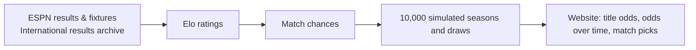

# SportsPred

Live winner predictions for soccer leagues and tennis tournaments, worked out from past results and refreshed every three hours.

**Covers:** Premier League, La Liga, Serie A, Bundesliga, Ligue 1, Champions League, Europa League, international tournaments while they're on, plus ATP and WTA Grand Slams and 1000-level events.

- **Live site:** https://amalmehta.github.io/SportsPred/
- [How to set it up, run it and use it](docs/INSTRUCTIONS.md)
- [System design](docs/SYSTEM-DESIGN.md)
- [What's where](docs/FILE-STRUCTURE.md)
- [How the predictions work](https://amalmehta.github.io/SportsPred/how.html)
