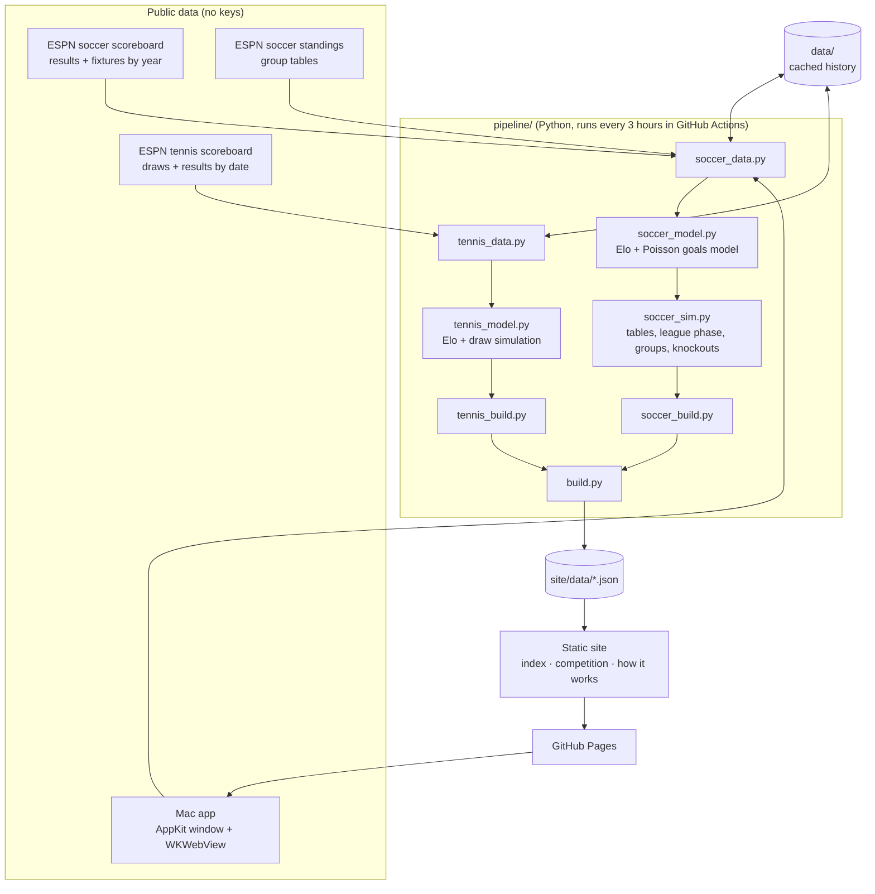

# System Design

SportsPred is a static website backed by a scheduled Python job. The job pulls public results, rates every team and player, simulates what's left of each competition, and writes JSON. The website only reads that JSON, so there's no server and no database.

## Architecture

## Components

| Component | Job |
|---|---|
| `soccer_data.py` | Fetches a calendar year of matches per competition from ESPN and turns each event into a compact match record (teams, score, status, stage, neutral venue, shoot-out winner). Finished years are cached in `data/soccer/`. Also reads group tables and the international results archive. |
| `soccer_model.py` | `Elo`: sequential ratings with a goal-difference multiplier, a home advantage, faster updates for new teams, and snapshots at chosen dates. `GoalsModel`: expected goals for each side = exp(base ± slope × rating gap / 400); goals are Poisson. It gives win/draw/loss chances and the likeliest score. `fit_goals_model` fits base and slope by maximum likelihood. |
| `soccer_sim.py` | Vectorised Monte Carlo (numpy). `sim_table` plays out remaining fixtures with per-simulation rating noise. Each format adds its own rules: leagues (top of the table), UEFA's 36-team league phase (then playoffs, round of 16, two-legged ties, one-off final), groups then knockout, and World Cup qualifying groups (`simulate_qualifying`: chance to top the group, qualify directly, or reach the playoff or next-round places). Knockout ties are solved exactly from goal-difference distributions, not sampled. Knockouts already under way are rebuilt from the real ties (aggregate scores, shoot-out winners). |
| `soccer_build.py` | Runs the club and international pipelines: fits home advantage by grid search, runs Elo once with snapshots, simulates each competition today plus once per past match day (odds over time), and assembles the JSON for each competition. |
| `tennis_data.py` | Queries ESPN every 3 days of the calendar, per tour, and keeps that tour's singles draw for each event. Events finished more than 2 weeks ago are frozen to `data/tennis/`, so later runs only fetch recent dates. `fetch_rankings` reads the current top 8 for projected Finals fields. |
| `tennis_model.py` | Tennis Elo (K = 250 / (matches + 5)^0.4, Slams × 1.1). Each player has an overall rating plus one each for hard, clay and grass (updated only by matches on that surface). Predictions use (1 − w) × overall + w × surface; `fit_surface_weight` picks w by log loss over the last year. Also holds `surface_of` (tournament name → surface), best-of-five conversion, `as_of` (the draw as it stood on a given day) and `simulate_draw`. For the season finales: `rr_groups` (groups worked out from who plays whom, because ESPN doesn't name them), `as_of_rr`, and `simulate_finals` (round robin → semis → final, with an optional projected field and seeded group draw). |
| `tennis_build.py` | Picks the Grand Slams, 1000-level events and the ATP/WTA Finals from 30 days ago to 45 days ahead, then simulates each one today and per past match day. For a finale with no groups yet, it fetches the top 8 in the rankings as a projected field. |
| `live_log.py` | Keeps each day's published odds (the headline number: title, or qualifying chance) in a `live` list inside each competition's JSON, one entry per day, for the current season only. Each run merges the local copy with the copy on the live site, then adds today's entry. |
| `build.py` | Entry point. Runs each part in isolation, so a failing part keeps its previous output. Writes `index.json` (competition summaries) and `model.json` (parameters and accuracy). |
| `mac/` | The Mac app: an AppKit window with a `WKWebView` showing the live site. It adds native menus (Settings ⌘, opens the site's settings panel; Go ⌘1–3; Back, Forward, Reload, Zoom; Help → Send Feedback), follows the page title in the window subtitle, opens off-site links in the default browser, refreshes when you return after 15 minutes, and shows an offline page with Try again. The web view's own storage keeps the site's settings between launches. |
| `site/` | Plain HTML, CSS and JavaScript, no build step. Chart.js (from cdnjs) draws the odds-over-time chart. `app.js` holds the shared header, settings dialog (⌘,), feedback tab, colour-coded tags and number formatting. |

## Main flows

**Scheduled refresh.** GitHub Actions (every 3 hours, on push, or by hand) restores `data/` from the cache, runs the tests, runs `python -m pipeline.build`, then uploads `site/` to GitHub Pages.

**A soccer prediction.**
1. Load every match from 2021 onwards for 13 competitions (the 7 predicted, plus 6 rating-only leagues so clubs from smaller leagues are rated through Europe).
2. Fit home advantage (grid of 40–100 Elo) and the goals model on matches since July 2022.
3. Run Elo over all finished matches, keeping each match's pre-match ratings and snapshots on every replay day.
4. For each competition, take its current season and simulate the remaining fixtures 10,000 times. The title chance is the share of simulations a team wins.
5. Replay: for each past match day, the same simulation (2,000 runs) uses only the results and ratings known that evening.

**World Cup qualifying.** Each confederation in `config.WC_QUALIFYING` is loaded alongside the international tournaments and stays hidden until it has fixtures in the next 300 days (none for 2030 as of Oct 2026). The groups come from ESPN standings, which describe the current stage. Only that stage's matches count: the latest stage played inside the groups, so earlier rounds don't leak into the tables. That stage's places (for example `"third": [2, 2, "Next round"]`) turn simulated finishing positions into chances. The chart follows chance to qualify for the 8 teams whose odds moved most.

**A tennis prediction.**
1. Rate every ATP or WTA singles match since 2024 in date order, tagging each with its tournament's surface, and update both the overall and the surface rating. Fit the surface blend w on the last 12 months.
2. For each covered event, rebuild the main draw. ESPN gives no bracket positions, so each known player is linked to the match they came from, and open (TBD) slots are filled at random from the unlinked winners of the round before.
3. Play the rest of the draw 10,000 times using each player's rating blended for that event's surface (best of five for men's Slams).
4. ATP/WTA Finals instead: groups come from the group-stage match graph (pieces of groups are joined at random while ESPN has only listed early matches). Every pair in a group of four meets once; standings go on wins, with a two-way tie decided by head-to-head. The semis pair each group winner with the other group's runner-up. Before any group is published, the projected top 8 is drawn into groups with seeds 1 and 2 kept apart and 3/4, 5/6 and 7/8 split. The table also shows the chance of reaching the semis.

## Where data lives

| Data | Location | Lifetime |
|---|---|---|
| Finished soccer years, finished tennis events | `data/` (committed seed, then the Actions cache) | Permanent |
| Current season / recent days | Refetched every run | – |
| Predictions | `site/data/*.json` (generated, git-ignored) | Rebuilt every run |
| Daily published odds (`live` in each competition file) | The published site; read back and extended every run | Current season or event |
| Viewer settings | Browser `localStorage` (`sportspred.settings`) | Per browser |

## Key decisions and trade-offs

- **Static site and a scheduled job, no server.** Free hosting, nothing to keep running, and the site loads instantly. The cost: predictions are only as fresh as the last run (up to 3 hours old), not truly live in-match.
- **Free, keyless sources (ESPN public JSON, martj42).** No sign-ups or secrets. ESPN's feed is undocumented and could change; parsing is defensive, and a failing part keeps its previous output.
- **Elo + Poisson instead of a machine-learning model.** Few parameters, easy to explain on the How It Works page, and well calibrated (backtests are on that page). It ignores lineups, injuries and surface.
- **One club rating scale across leagues.** European matches link the leagues; six extra leagues improve coverage of European opponents. Cross-league gaps are still the least certain part of the model.
- **Rating noise in simulations (sd 50 Elo).** Without it, fixed ratings make long-range odds overconfident (Arsenal's 2026–27 pre-season chance went from 83% to 70% once it was added).
- **Odds over time by replay, not stored snapshots.** The chart is rebuilt each run from what was known on each day. It has full history from the first run and needs no stored state. If the model changes, the whole history is redrawn consistently.
- **Surface ratings blended with overall, by name lookup.** ESPN publishes no surface, so `config.TENNIS_SURFACES` maps tournament names to clay or grass, and everything else is hard. A separate surface rating alone is noisy (grass has few matches), so it is blended with the overall rating, and the data picks the mix. On the last year this lifted ATP from 63.7% to 63.9% called and WTA from 63.6% to 64.0%, with lower log loss on both. The blend is one parameter fitted and scored on the same year, so the gain is slightly optimistic.
- **Projected Finals field before the draw (user's choice).** Odds are available weeks earlier, at the cost of a stand-in field (52-week top 8 instead of the Race), clearly labelled on the page.
- **World Cup qualifying built ahead of time (user's choice).** It was built in October 2026 with no 2030 qualifiers scheduled, so it was checked by replaying the 2026 cycle with `SPORTSPRED_TODAY`. As of 1 Oct 2025, the model's favourite topped 11 of 12 European groups (the miss was Scotland, 19%). As of 1 Mar 2025, it gave Paraguay 83% to qualify from South America, which they did. Replays can't reproduce the past group lineup (ESPN standings only show the current stage), so a replay of an early date shows the latest stage's groups.
- **Live odds stored on the published site, not in git.** Every run reads the previous `live` log from `SITE_URL` and republishes it with today's entry, so there are no bot commits or extra storage. Trade-off: if the site is deleted or unreachable for a whole day, that day is missing, and the log restarts if the site itself is lost. A failed deploy is harmless, because the next run reads the last good version. The chart shows the published dots next to the replay lines. The two differ when ratings settle after the fact or the model changes, which is what the comparison is for.
- **Mac app wraps the live site instead of bundling it.** It always shows the latest predictions without app updates, and the site and app can't drift apart. Trade-off: it needs an internet connection, and the app is only ad-hoc signed (not notarised), so other Macs need right-click → Open the first time.
- **Exact knockout-tie maths.** Tie probabilities come from convolving goal-difference distributions, so they're cached per pairing and the per-simulation loop stays cheap.
- **Approximate brackets.** The UEFA draw (seeded pairs) and tennis open slots are approximated, as described above.

## Testing

- Mac app: built with `mac/build-app.sh` (universal binary, signature verified) and checked by hand: the live site loads, Settings… (⌘,) opens the settings panel, the Go menu navigates, and the subtitle follows the page.

- `tests/test_models.py` (26 unit tests, no network): probabilities sum to one and follow rating gaps, Elo is zero-sum and snapshots are taken in the right order, the goals-model fit recovers known parameters, tie maths is symmetric and respects aggregate leads, knockout state reads aggregates and shoot-outs, best-of-five helps favourites, draw simulation handles TBD slots, `as_of` undoes later results, the surface lookup works, surface ratings only move on their own surface, the blend fit prefers surface ratings when results really do split by surface, and finales get their groups from the match graph, settle two-way ties by head-to-head, return title odds summing to 1 and semi odds summing to 4, keep the top two seeds apart in projected draws, and `as_of_rr` hides semi-final players until the groups are done, the live log keeps the latest entry per day and drops other seasons, and it logs the right headline number per format.
- Backtest on every build: each match in the last 12 months is scored against its pre-match prediction (accuracy, Brier score, log loss, predicted vs actual draw rate). Results are in `model.json` and on the How It Works page. Tennis also reports `backtest_overall_only`, so the surface gain stays visible.
- CI runs the tests before every build, and a failing test blocks publishing.

## Known limits

- No injuries, suspensions, transfers or lineups.
- Tennis surfaces come from a name list; unlisted events count as hard, and indoor and outdoor hard courts are treated alike.
- Points deductions and head-to-head tie-breakers aren't modelled.
- The UEFA knockout draw is approximated by seeding; tennis open slots aren't placed in the exact half of the draw.
- ATP/WTA Finals: three-way ties are split at random (not by sets/games). Before the draw, the field comes from the 52-week rankings (ESPN has no Race), so withdrawals and alternates only appear once the real draw does.
- The Next Gen ATP Finals aren't predicted.
- World Cup qualifying uses the 2026 cycle's places until 2030's are confirmed; "best runners-up" rules are simplified to every runner-up; Oceania (knockout only) isn't covered; inter-confederation playoffs aren't simulated.
- Tennis events only get odds once ESPN publishes the main draw.
- Independent Poisson goals slightly under-predict draws (about 22.7% predicted vs 24.1% actual for clubs).
